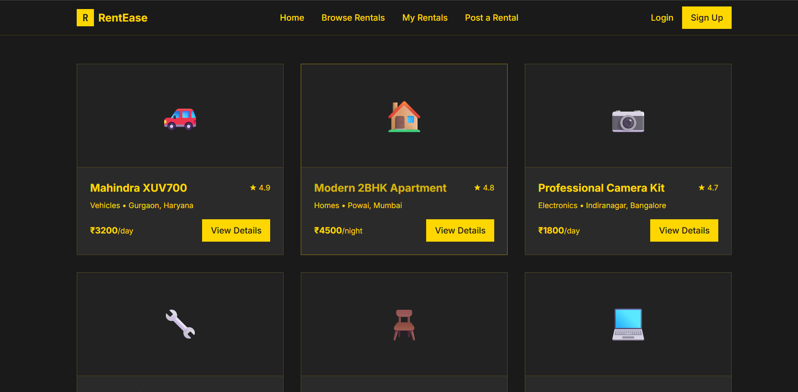
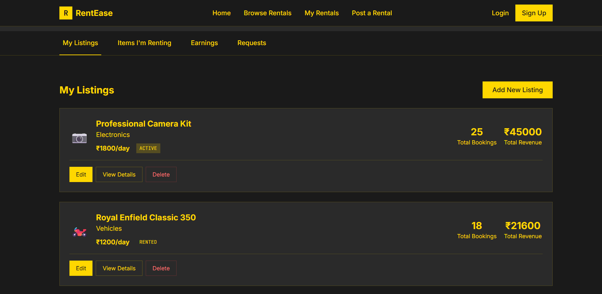
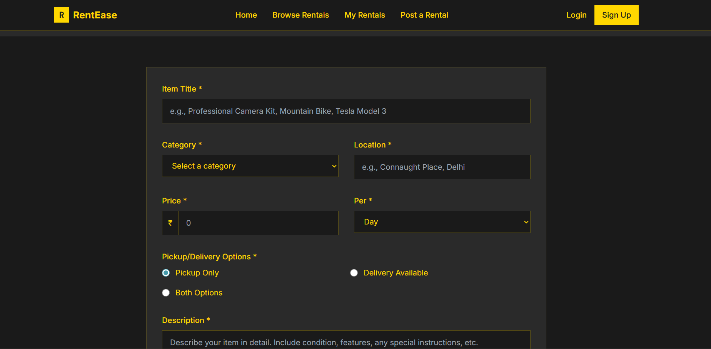

# RentEase – Multi-Category Rental Marketplace

RentEase is a full-stack web-based rental marketplace that allows users to browse rental listings, post items for rent, and manage rental requests across multiple categories.

## Features

- User registration and login with JWT authentication
- Create, view, update and delete rental listings
- Browse and search rental listings
- Filter listings by category, price and location
- Support for properties, vehicles, electronics, furniture, tools and equipment, agriculture equipment, and sports and recreation
- Upload images for rental listings
- Submit rental requests to listing owners
- Approve and reject rental requests
- Track sent and received rental requests
- User dashboard with listing and request statistics
- Admin dashboard with platform statistics and management views
- Newsletter subscription

## Technology Stack

**Frontend**
- React 18
- JavaScript
- Vite
- Redux Toolkit
- React Query
- Tailwind CSS
- React Router DOM

**Backend**
- Python
- Django
- Django REST Framework
- Simple JWT

**Database**
- SQLite

## Project Structure

```text
RentEase/
├── frontend/
│   ├── public/
│   ├── src/
│   ├── package.json
│   └── .env.sample
│
├── backend/
│   ├── authentication/
│   ├── houses/
│   ├── rentease_backend/
│   ├── manage.py
│   └── requirements.txt
│
└── README.md
```

## Screenshots

### Home Page


### Browse Rentals


### Rental Listings


## Installation and Setup

### Prerequisites
- Python
- Node.js
- npm

### Backend Setup

```bash
cd backend

python -m venv venv
```

Activate the virtual environment on Windows:

```powershell
venv\Scripts\Activate.ps1
```

Install dependencies:

```bash
pip install -r requirements.txt
```

Apply migrations:

```bash
python manage.py migrate
```

Start the backend server:

```bash
python manage.py runserver
```

Backend URL: http://localhost:8000

### Frontend Setup

Open another terminal:

```bash
cd frontend
npm install
```

Create a `.env` file using `.env.sample`.

Configure the API URL:

```env
VITE_API_BASE_URL=http://localhost:8000/api
```

Start the frontend:

```bash
npm run dev
```

Frontend URL: http://localhost:5173

## Author

**Shwetha Nayak**

GitHub: https://github.com/Shwetha810
